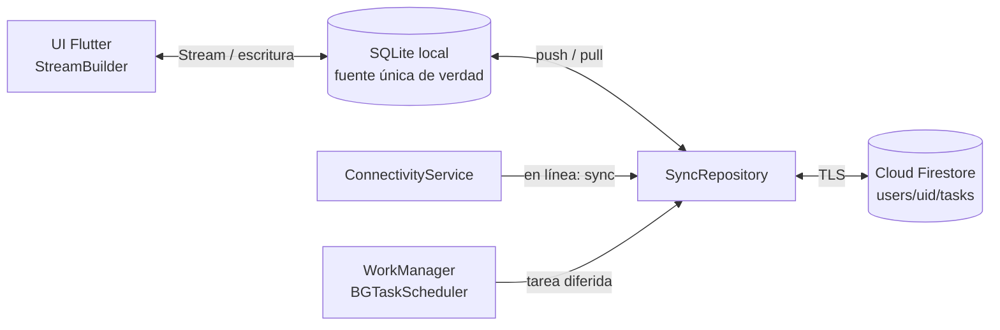
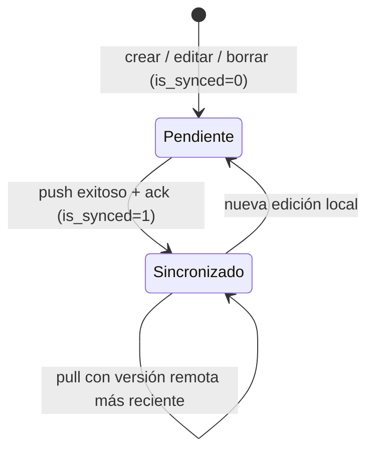

# Documentación Técnica — Arquitectura Offline-First en Flutter (iOS)
**Asignatura:** Desarrollo Móvil Integral · Semana 11 · Cierre de Unidad II
**Programa:** Ingeniería en Desarrollo de Software 10° · UTXJ
**Autor:** [Nombre completo] · **Fecha:** 2026-11-20 · **Versión:** 1.0
**Repositorio:** [URL del repositorio]
## 1. Resumen
Aplicación móvil de gestión de tareas para iOS que opera sin conexión a internet. SQLite local es la única fuente de verdad; la interfaz solo escucha Streams locales y la sincronización con la nube (Firebase Auth anónima + Cloud Firestore) ocurre en segundo plano y al recuperar conectividad. Los conflictos se resuelven por Last-Write-Wins (LWW) con `updated_at` en UTC.
| Capa | Tecnología | Paquete |
|---|---|---|
| Base de datos local | SQLite | `sqflite`, `path` |
| Monitor de conectividad | Interfaz de red | `connectivity_plus` |
| Tareas en segundo plano | BGTaskScheduler (iOS) | `workmanager` |
| Identificadores únicos | UUID v4 | `uuid` |
| Backend | Auth anónima + Firestore | `firebase_auth`, `cloud_firestore` |
| Secretos | Keychain iOS | `flutter_secure_storage` |
## 2. Arquitectura

| Componente | Responsabilidad |
|---|---|
| `TaskRepository` | CRUD local, bandera `is_synced`, Stream reactivo de tareas visibles |
| `RemoteTaskSource` | Acceso a Firestore, push condicionado a LWW, descarga del usuario |
| `SyncRepository` | Ciclo push → ack → pull → merge con bloqueo de reentrada |
| `ConnectivityService` | Escucha de red, indicador offline, disparo de sincronización |
| `background.dart` | Tarea diferida con restricción de red, ejecutada en otro isolate |
| `SessionService` | Cierre de sesión y purga de la base local |
Principios: (1) toda escritura va primero a disco, sin esperar red; (2) la UI nunca lee de la nube; (3) un registro se considera pendiente mientras `is_synced = 0`.
## 3. Modelo de datos
### 3.1 SQLite local (tabla `tasks`)
```sql
CREATE TABLE tasks (
  id TEXT PRIMARY KEY,
  title TEXT NOT NULL,
  is_synced INTEGER DEFAULT 0,
  updated_at TEXT NOT NULL,
  is_deleted INTEGER DEFAULT 0
);
```
| Columna | Tipo | Restricción | Descripción y justificación |
|---|---|---|---|
| `id` | TEXT | PK | UUID v4 generado en el cliente; permite crear registros offline sin colisión y hace idempotente el push |
| `title` | TEXT | NOT NULL | Contenido de la tarea; 1 a 200 caracteres (validado en cliente y en reglas) |
| `is_synced` | INTEGER | DEFAULT 0 | Bandera sucia: 0 pendiente de subir, 1 sincronizado |
| `updated_at` | TEXT | NOT NULL | ISO-8601 en UTC; criterio de resolución de conflictos |
| `is_deleted` | INTEGER | DEFAULT 0 | Borrado lógico (tombstone): permite propagar eliminaciones a la nube y a otros dispositivos |
### 3.2 Firestore (remoto)
Ruta: `users/{uid}/tasks/{id}`. El ID del documento es el UUID del registro.
| Campo | Tipo | Notas |
|---|---|---|
| `id` | string | Debe coincidir con el ID del documento (lo exigen las reglas) |
| `title` | string | 1 a 200 caracteres |
| `updated_at` | string | ISO-8601 UTC |
| `is_deleted` | bool | Tombstone; no existe borrado físico |
`is_synced` es un metadato exclusivamente local y no se envía al servidor.
### 3.3 Estados de un registro

## 4. Sincronización y conflictos
Ciclo bidireccional:
| Paso | Acción |
|---|---|
| 01 PUSH | Se envían los registros con `is_synced = 0`; en servidor la escritura es una transacción que solo aplica si el remoto no es más reciente |
| 02 ACK | Se marca `is_synced = 1` únicamente si `updated_at` local no cambió durante el envío |
| 03 PULL | Se descargan los documentos del usuario |
| 04 MERGE | Se reemplaza el registro local solo si `remoto.updated_at` es posterior al local |
Disparadores: recuperación de conectividad, regreso de la app a primer plano, botón de sincronización manual y tarea diferida (WorkManager). Un indicador de reentrada impide sincronizaciones concurrentes.
**Estrategia de conflictos: Last-Write-Wins.** Idónea para registros individuales y catálogos. Se elige sobre el control de versiones por su simplicidad y porque el dominio (tareas de un solo usuario) no maneja saldos ni inventarios críticos.
Garantías:
- **Idempotencia:** reintentar un push produce el mismo documento (misma clave UUID).
- **Sin pérdida por carrera:** el ACK condicionado a `updated_at` evita marcar como sincronizada una edición hecha durante el envío.
- **Sin pisado de cambios nuevos:** un cambio local pendiente más reciente no se sobrescribe con una versión remota antigua.
## 5. Cifrado y protección de datos
### 5.1 Controles
| Requisito | Control | Estado |
|---|---|---|
| Cifrado en reposo de secretos | Los secretos propios se guardan solo en `flutter_secure_storage` (Keychain). La app no almacena tokens propios: los tokens de sesión los gestiona el SDK de Firebase Auth en el Keychain del sistema | Implementado (dependencia incluida; sin secretos propios que guardar) |
| Datos de usuario en SQLite | Archivo dentro del sandbox de la app con la protección de datos de iOS. No se cifra a nivel de aplicación | Implementado (sandbox); cifrado con SQLCipher recomendado si los datos fueran sensibles |
| Cifrado en tránsito | Firebase usa TLS; no se desactiva App Transport Security ni se añaden excepciones | Implementado |
| Idempotencia en API | UUID v4 generado en el cliente como ID de documento | Implementado |
| Reglas de seguridad | Validación del UID autenticado, esquema y longitud en el servidor | Implementado (sección 6) |
| Limpieza de sesión | `signOutAndPurge()` cierra sesión y vacía la tabla local | Implementado |
| Inyección SQL | Consultas parametrizadas (`whereArgs`) | Implementado |
| Validación de entrada | Título no vacío y máximo 200 caracteres en cliente y en reglas | Implementado |
| Registros (logs) | Solo se registra el tipo de excepción; nunca títulos, UID ni tokens | Implementado |
| Secretos en el repositorio | `GoogleService-Info.plist` y `firebase_options.dart` excluidos con `.gitignore`; se regeneran con `flutterfire configure` | Implementado |
| Integridad de la app | Firebase App Check (App Attest) y restricción de la API key | Recomendado |
### 5.2 Consideraciones
- La purga al cerrar sesión descarta cambios no sincronizados; una app productiva debe sincronizar antes o advertir al usuario.
- La autenticación anónima acota el alcance de la práctica (provee UID para las reglas). Un cierre de sesión anónimo no es recuperable; en producción se usaría correo y contraseña, Apple o Google.
- La clave de API de Firebase identifica el proyecto y no es un secreto por sí misma; la protección real la dan las reglas de seguridad y App Check.
## 6. Reglas de seguridad del backend (Firestore)
```
rules_version = '2';
service cloud.firestore {
  match /databases/{database}/documents {
    match /users/{uid}/tasks/{taskId} {
      allow read: if request.auth != null && request.auth.uid == uid;
      allow create, update: if request.auth != null && request.auth.uid == uid
        && request.resource.data.keys().hasOnly(['id','title','updated_at','is_deleted'])
        && request.resource.data.id == taskId
        && request.resource.data.title is string
        && request.resource.data.title.size() > 0
        && request.resource.data.title.size() <= 200
        && request.resource.data.updated_at is string
        && request.resource.data.is_deleted is bool;
      allow delete: if false;
    }
  }
}
```
| Regla | Efecto |
|---|---|
| `request.auth != null` | Rechaza accesos no autenticados |
| `request.auth.uid == uid` | Aislamiento por usuario: nadie lee ni escribe en la ruta de otro |
| `hasOnly([...])` | Impide campos arbitrarios (mass assignment) |
| `id == taskId` | Coherencia entre clave y contenido; sustenta la idempotencia |
| Tipo y longitud de `title` | Validación de entrada en servidor |
| `delete: false` | Solo borrado lógico; conserva tombstones para sincronizar |
Verificación recomendada: Firebase Console → Firestore → Rules → Rules Playground, simulando (a) lectura sin autenticar, (b) lectura con otro UID, (c) escritura con título vacío, (d) escritura con campo extra, (e) delete. Todas deben ser rechazadas.
## 7. Pruebas y evidencias
Ejecutadas en iPhone físico. Las pruebas 2 y 3 en build `--release`, porque una build debug no puede abrirse desde el icono en iOS 14 o posterior.
| # | Escenario | Resultado esperado | Resultado obtenido | Evidencia |
|---|---|---|---|---|
| 1 | Modo avión: crear 3 tareas y editar 1 | Persisten localmente; 3 iconos de reloj; banner offline | [completar] | [captura] |
| 2 | Cierre forzado y reapertura sin red | Las 3 tareas siguen presentes | [completar] | [captura] |
| 3 | Reconexión | Iconos pasan a check; documentos visibles en `users/{uid}/tasks` | [completar] | [captura de consola] |
| 4 | Conflicto LWW | Prevalece el valor con `updated_at` más reciente | [completar] | [captura] |
| 5 | Tarea en segundo plano (`_simulateLaunchForTaskWithIdentifier`) | Sincroniza sin abrir la UI | [completar] | [captura de Xcode] |
| 6 | Reglas: acceso con otro UID / dato inválido | Rechazo (permission-denied) | [completar] | [captura del Playground] |
## 8. Limitaciones y trabajo futuro
- **Reloj del dispositivo:** LWW depende de `updated_at` generado en el cliente; un reloj desajustado puede dar un ganador incorrecto. Alternativas: campo `version` incremental o marca de tiempo del servidor.
- **Descarga completa:** `fetchAll` es suficiente a esta escala; en producción se usa un cursor incremental por `updated_at`.
- **Segundo plano en iOS:** BGTaskScheduler ejecuta las tareas a discreción del sistema (batería, uso, cierre forzado); por ello el listener de conectividad en primer plano es el mecanismo principal. El simulador no ejecuta tareas de fondo.
- **`connectivity_plus`** informa la interfaz de red, no el alcance real a internet; la sincronización se protege con `try/catch` y reintenta en el siguiente evento.
- **Cifrado de SQLite** a nivel de aplicación (SQLCipher) y **App Check** quedan como mejoras.
- **Autenticación** anónima solo para fines didácticos.
## 9. Alineación con estándares
| Control | OWASP MASVS / Mobile Top 10 | NIST (referencia) |
|---|---|---|
| Almacenamiento seguro, limpieza de sesión | MASVS-STORAGE · M9 Insecure Data Storage | SP 800-111 (cifrado de almacenamiento) |
| Reglas por UID, aislamiento de usuarios | MASVS-AUTH · M3 Insecure Authentication/Authorization | SP 800-63 (identidad digital) |
| TLS, sin excepciones ATS | MASVS-NETWORK · M5 Insecure Communication | SP 800-52 (TLS) |
| Validación de entrada, SQL parametrizado | MASVS-CODE · M4 Insufficient Input/Output Validation | SP 800-218 (SSDF) |
| Dependencias fijadas y revisadas | M2 Inadequate Supply Chain Security | SP 800-218 (SSDF) |
## 10. Trazabilidad con la práctica
| Requisito del PDF | Sección |
|---|---|
| Single Source of Truth con SQLite | 2, 3.1 |
| Metadatos de sincronización (`is_synced`, `updated_at`, `is_deleted`) | 3.1 |
| Escritura local inmediata | 2, 4 |
| Detección de red y disparo automático | 2, 4 |
| WorkManager con restricción de red | 2, 4, 8 |
| Push, ACK, Pull, Merge | 4 |
| Pruebas: modo avión, cierre forzado, reconexión | 7 |
| Cifrado en reposo, idempotencia, reglas, limpieza de sesión | 5, 6 |
| Repositorio con commits continuos y protección de datos | 5.1 (`.gitignore`), historial de Git |